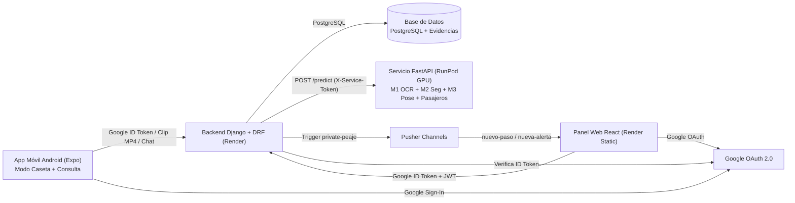

# Smart Peaje — Sistema Inteligente de Control de Peaje

Sistema de control de peaje de punta a punta con visión por computadora (detección de placas + OCR, segmentación de vehículos, estimación de ejes por keypoints y conteo anónimo de pasajeros), backend REST en Django, panel web en tiempo real con React + Pusher, agente consultivo y aplicación móvil Android en Expo, autenticado exclusivamente con Google OAuth 2.0.

> **Advertencia de seguridad:** Nunca subas archivos `.env`, tokens, llaves privadas ni `client secret` de Google al repositorio. Usa únicamente `.env.example` como referencia y configura los secretos en Render, RunPod y EAS.

---

## Autor y Roles

| Integrante | Rol | Responsabilidad |
|---|---|---|
| **Franz Jhostin Orozco Salazar** | Desarrollador Full-Stack e IA (Proyecto Individual) | Datasets Roboflow/Zenodo, entrenamiento M2/M3, integración M1/M4 (`pasajeros.pt`), API FastAPI en RunPod GPU, Backend Django + PostgreSQL + Google OAuth + Pusher + Agente IA en Render, Panel Web React y App Móvil Android (Expo EAS APK) |

---

## Enlaces de Producción, Entregables y Datasets

- **Subdominio Web (HTTPS):** https://peaje-frontend.onrender.com
- **Backend API (HTTPS):** https://peaje-backend.onrender.com/api/v1/
- **Documentación API (Swagger UI):** https://peaje-backend.onrender.com/api/v1/docs/
- **Repositorio Git:** https://github.com/franzorozco/smart-peaje
- **Carpeta de Evidencias (Google Drive):** https://drive.google.com/drive/folders/1nxYsQhm4sfrJEDrp_BQym_xJyRkb15CX?usp=sharing
- **Endpoint de Inferencia (RunPod GPU):** configurado dinámicamente vía `INFERENCE_URL` en Render (puerto `8000` expuesto sobre proxy HTTPS de RunPod)
- **Dataset M2 — Segmentación vehicular (Roboflow Universe):** [Vehicle Classification V2 (v1)](https://universe.roboflow.com/franz-orozco/vehicle-classification-v2-t9ukm/dataset/1)
- **Dataset M3 — Original (Roboflow Universe):** [Vehicle Wheel Pose (`trafficanalyse`)](https://universe.roboflow.com/trafficanalyse/vehicle_wheel_pose)
- **Dataset M3 — Complementario (USP / Zenodo):** [Truck Image Dataset v2.0.0](https://zenodo.org/records/7695824) — DOI: [10.5281/zenodo.7695824](https://doi.org/10.5281/zenodo.7695824) | Publicación: [arXiv:2204.01868](https://arxiv.org/abs/2204.01868) (licencia **CC BY 4.0**)
- **Modelo M4 — Pasajeros (Ultralytics COCO 2017 Segmentation):** [COCO Segmentation (`YOLOv8n-seg`, clase `0: person`)](https://docs.ultralytics.com/datasets/segment/coco/)

---

## Datasets y Fuentes de Entrenamiento (Originales vs. Adaptados)

### M1 — Detección de placas y OCR (reutilizado del laboratorio anterior en `/placas/`)
- **Fuente comprobable en el repositorio:** artefactos del laboratorio previo ubicados en `/placas/` (sin modificar):
  - Detector ONNX: `placas/modelo/yolo-v9-t-384-license-plates-end2end.onnx` (entrada 384×384, invocado vía `placas/detector.py` y `inferencia/ocr_adapter.py`).
  - OCR ONNX: `placas/modelo/cct_xs_v2_global.onnx` + `placas/modelo/cct_xs_v2_global_plate_config.yaml` mediante `fast-plate-ocr` (`LicensePlateRecognizer`, ver `placas/placas_fastocr.py`).
  - No se añaden enlaces externos adicionales no verificables para M1.

### M2 — Segmentación de instancias vehiculares (`vehiculos.pt`)
- **Dataset público original:** **Vehicle Classification V2** (versión 1), publicado en Roboflow Universe: https://universe.roboflow.com/franz-orozco/vehicle-classification-v2-t9ukm/dataset/1 (`3.680` imágenes originales, formato YOLOv8-seg).
- **Dataset adaptado del proyecto:** tras limpieza, depuración de etiquetas y validación quedaron **1.798 imágenes**, distribuidas en **1.268 entrenamiento**, **367 validación** y **163 prueba** (5 clases: `auto`, `bus`, `camion`, `minibus`, `moto`).
- **Notebook de entrenamiento:** `entrenamiento/M2_segmentacion.ipynb` (`yolov8n-seg.pt`, `imgsz=640`).

### M3 — Detección y conteo de ejes (`ejes.pt`)
- **Datasets públicos originales:**
  1. **Vehicle Wheel Pose** (`trafficanalyse`, Roboflow Universe): https://universe.roboflow.com/trafficanalyse/vehicle_wheel_pose (formato COCO JSON con anotaciones de vehículos y ruedas).
  2. **Truck Image Dataset v2.0.0** — Leandro Arab Marcomini & André Luiz Cunha (Universidad de São Paulo, Brasil): https://zenodo.org/records/7695824 | DOI: https://doi.org/10.5281/zenodo.7695824 | Publicación científica: Marcomini & Cunha (2022), *Truck Axle Detection with Convolutional Neural Networks*, https://arxiv.org/abs/2204.01868 | Licencia: **Creative Commons Attribution 4.0 International (CC BY 4.0)**.
- **Dataset adaptado y combinado del proyecto (`m3_adaptado_v2`):**
  - **Transformaciones:** unificación de anotaciones de ambas fuentes a formato YOLO-pose de una sola clase (`vehiculo`) con esquema uniforme `kpt_shape: [7, 3]` (`eje_1..eje_7` ordenados de frente a atrás), verificación de duplicados por hash MD5 (`0` cruces entre splits) y auditoría de vehículos con >7 ejes.
  - **Distribución final:** **1.513 imágenes** y **3.619 instancias vehiculares**, distribuidas en **1.031 entrenamiento**, **318 validación** y **164 prueba**.
  - **Scripts de conversión:** `entrenamiento/convertir_coco_m3.py` (v1) y `entrenamiento/convertir_m3_v2.py` (v2 combinado).
  - **Notebook de entrenamiento:** `entrenamiento/M3_keypoints.ipynb` (`yolov8n-pose.pt`, `imgsz=640`).

> El detalle completo de fuentes, licencias, transformaciones y métricas reales está documentado en [`docs/metricas.md`](docs/metricas.md).

---

## Arquitectura del Sistema



---

## Tecnologías y Estructura del Repositorio

- **Inferencia (`/inferencia` + `/placas`):** Python 3.12, FastAPI, Uvicorn, Ultralytics YOLO (seg & pose), ONNX Runtime, `fast-plate-ocr`, OpenCV.
- **Backend (`/web/backend`):** Python 3.12, Django 6, Django REST Framework, SimpleJWT, `drf-spectacular`, `google-auth`, `pusher`, `psycopg`, Gunicorn, WhiteNoise, PostgreSQL.
- **Frontend (`/web/frontend`):** React 19, Vite, Axios, React Router, `@react-oauth/google`, `pusher-js`, Chart.js, Lucide React.
- **Móvil (`/movil`):** Expo SDK 58, Expo Router, `expo-camera`, `expo-image-picker`, `expo-secure-store`, `expo-crypto`, `@react-native-google-signin/google-signin`, EAS Build.
- **Entrenamiento (`/entrenamiento`):** Notebooks Google Colab para M2 (`M2_segmentacion.ipynb`) y M3 (`M3_keypoints.ipynb`).
- **Documentación (`/docs`):** Diagramas, checklist de pruebas, métricas reales y esquema OpenAPI (`docs/openapi.yaml`).

---

## Recrear Entornos Locales (Entornos Reproducibles)

### 1. Servicio de Inferencia (`/inferencia`)
```powershell
cd inferencia
uv venv .venv --python 3.12
.\.venv\Scripts\Activate.ps1
uv pip install -r requirements.txt
python diagnostico.py
```

### 2. Backend Django (`/web/backend`)
```powershell
cd web\backend
uv venv .venv --python 3.12
.\.venv\Scripts\Activate.ps1
uv pip install -r requirements.txt
python diagnostico.py
```

### 3. Frontend Web (`/web/frontend`)
```powershell
cd web\frontend
npm ci
```

### 4. Aplicación Móvil (`/movil`)
```powershell
cd movil
npm ci
```

---

## Dónde colocar los pesos entrenados (M2, M3 y M4)

1. Coloca `vehiculos.pt` (M2, 5 clases: `moto`, `auto`, `minibus`, `camion`, `bus`), `ejes.pt` (M3, detección de llantas/ejes) y `pasajeros.pt` (M4, `YOLOv8n-seg` COCO `person` ID `0`) en **`inferencia/modelos/`**.
2. También puedes definir `M2_URL`, `M3_URL` y `M4_URL` y ejecutar `python inferencia/descargar_modelos.py` (`pasajeros.pt` se descarga automáticamente desde el release oficial de Ultralytics si no existe).
3. Estos archivos `.pt` están excluidos en `.gitignore` para no saturar Git.

---

## Ejecución en Desarrollo Local

1. **Servicio de Inferencia (puerto 8001):**
```powershell
cd inferencia
$env:INFERENCE_TOKEN = "dev"
$env:INFERENCE_DEMO = "1"   # Usar 0 cuando ya tengas vehiculos.pt y ejes.pt
.\.venv\Scripts\python.exe -m uvicorn main:app --host 0.0.0.0 --port 8001 --reload
```

2. **Backend Django (puerto 8000):**
```powershell
cd web\backend
Copy-Item .env.example .env -ErrorAction SilentlyContinue
.\.venv\Scripts\python.exe manage.py migrate
.\.venv\Scripts\python.exe manage.py seed_inicial
.\.venv\Scripts\python.exe manage.py runserver 0.0.0.0:8000
```

3. **Frontend React (puerto 5173):**
```powershell
cd web\frontend
Copy-Item .env.example .env -ErrorAction SilentlyContinue
npm run dev
```

4. **Móvil Expo (requiere compilación nativa para Google Sign-In):**
```powershell
cd movil
Copy-Item .env.example .env -ErrorAction SilentlyContinue
npx expo start --dev-client
```

---

## Despliegue a Producción (Sin Recursos Locales)

### Paso 1 · Google Cloud Console (OAuth 2.0)
1. Crea un proyecto en Google Cloud Console y configura la **Pantalla de consentimiento OAuth**. Si está en modo pruebas, agrega los correos autorizados (incluido `doc.alvaro.pinto.ma@unifranz.edu.bo`).
2. Crea un **ID de cliente OAuth — Aplicación Web**:
   - Orígenes autorizados de JavaScript: `https://<tu-frontend>.onrender.com` (y `http://localhost:5173` para pruebas locales).
   - Copia ese `Client ID` como `GOOGLE_WEB_CLIENT_ID`, `VITE_GOOGLE_CLIENT_ID` y `EXPO_PUBLIC_GOOGLE_WEB_CLIENT_ID`.
3. Crea un **ID de cliente OAuth — Android**:
   - Nombre de paquete: `bo.edu.peajelab.app`.
   - Huella digital SHA-1: obtén el SHA-1 del keystore de EAS ejecutando `npx eas-cli credentials -p android` dentro de `movil/`.
   - **Nota:** La app Android usa el `webClientId` al configurar `GoogleSignin.configure(...)` para obtener el `idToken` verificable por Django.

### Paso 2 · Pusher Channels
1. Crea una app Channels en [pusher.com](https://pusher.com) y habilita la app en tu región (cluster).
2. Copia `app_id`, `key`, `secret` y `cluster` en las variables del backend (`PUSHER_*`) y `key`/`cluster` en el frontend (`VITE_PUSHER_*`).

### Paso 3 · RunPod (Servicio de Inferencia GPU)
1. Crea un GPU Pod con plantilla PyTorch 2.x y expón el puerto HTTP `8000`.
2. Configura en el Pod las variables `INFERENCE_TOKEN` (un secreto largo y seguro), `INFERENCE_DEMO=0` y opcionalmente `M2_URL` / `M3_URL`.
3. Clona el repo y ejecuta la instalación:
```bash
cd /workspace
git clone <URL_DEL_REPO> sistema-peaje
cd sistema-peaje/inferencia
bash runpod_setup.sh
```
4. Copia `vehiculos.pt` y `ejes.pt` en `/workspace/sistema-peaje/inferencia/modelos/` (si no usaste `M2_URL`/`M3_URL`) y arranca:
```bash
source .venv/bin/activate
bash start.sh
```
5. Verifica `https://<pod-id>-8000.proxy.runpod.net/health`. Tu `INFERENCE_URL` será `https://<pod-id>-8000.proxy.runpod.net/predict`.

### Paso 4 · Render (Backend Django + PostgreSQL + Frontend React)
1. Sube el código a GitHub/GitLab.
2. En Render, elige **New > Blueprint** y selecciona el repositorio (`render.yaml` en la raíz crea la base `peaje-db`, `peaje-backend` y `peaje-frontend`).
3. Completa las variables pendientes en **Environment**:
   - En `peaje-backend`: `ALLOWED_HOSTS`, `WEB_ORIGINS`, `GOOGLE_WEB_CLIENT_ID`, `INFERENCE_URL`, `INFERENCE_TOKEN`, `PUSHER_*`, `ADMIN_EMAILS`, `OPERADOR_EMAILS`.
   - En `peaje-frontend`: `VITE_API_URL` (`https://<tu-backend>.onrender.com/api/v1`), `VITE_GOOGLE_CLIENT_ID`, `VITE_PUSHER_KEY`, `VITE_PUSHER_CLUSTER`.
4. Al iniciar `peaje-backend`, ejecuta automáticamente `migrate` y `seed_inicial` (autorizando a `doc.alvaro.pinto.ma@unifranz.edu.bo` como administrador y creando los 20 vehículos, caseta y tarifas).

### Paso 5 · Compilar APK Android con EAS
1. Configura `movil/eas.json` (`preview.env`) o los secrets de EAS con `EXPO_PUBLIC_API_URL` y `EXPO_PUBLIC_GOOGLE_WEB_CLIENT_ID`.
2. Ejecuta:
```powershell
cd movil
npx eas-cli login
npx eas-cli build --platform android --profile preview
```
3. Descarga el APK desde el enlace de EAS, registra su SHA-1 en Google Cloud Console (Paso 1.3) y súbelo también a la carpeta de evidencias en la nube.
