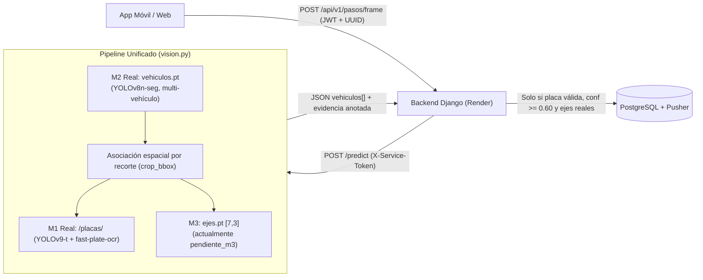

# Integración de M2 — Segmentación y Clasificación Vehicular (`vehiculos.pt`)

Documento técnico de la integración real del modelo **M2** (`YOLOv8n-seg`) en el sistema **Smart Peaje**, manteniendo compatibilidad con **M1** (`/placas/`) y dejando preparada la incorporación inmediata de **M3** (`ejes.pt`, `kpt_shape: [7, 3]`).

---

## 1. Archivos modificados y recursos utilizados

### Recursos reales incorporados (sin modificar)
- `inferencia/modelos/vehiculos.pt` — Pesos YOLOv8n-seg entrenados (50 épocas, 640×640, SHA-256 `8d47707a902421da...`).
- `inferencia/modelos/vehiculos.manifest.json` — Manifiesto oficial con clases, entorno y métricas en test (`box_mAP50: 0.9455`, `mask_mAP50: 0.9443`).
- `entrenamiento/notebooks/M2_segmentacion_vehiculos.ipynb` — Notebook de entrenamiento.

### Archivos actualizados en la integración
| Archivo | Cambio realizado |
|---|---|
| `inferencia/config.py` | Añade `CONF_M2=0.50`, `IOU_M2=0.45`, `CONF_M2_COBRO=0.60`, `M2_MANIFEST_PATH`, `M3_MANIFEST_PATH` y selección automática de GPU (`INFERENCE_DEVICE=auto`). |
| `inferencia/vision.py` | Carga única de `vehiculos.pt` al iniciar con validación contra `vehiculos.manifest.json` y `model.task == "segment"`. Inferencia multi-vehículo devolviendo `id_deteccion`, `clase_id`, `categoria`, `confianza_categoria`, `confianza_incierta`, `bbox`, `mascara_poligono` y `zona_asociacion`. Dibuja máscaras semi-transparentes, cajas y confianzas por clase. Mientras falte `ejes.pt`, devuelve explícitamente `ejes: null`, `ejes_estado: "pendiente_m3"`, `m3_disponible: false` sin inventar ejes. |
| `inferencia/.env.example` y `.env.example` | Documentan `CONF_M2=0.50`, `IOU_M2=0.45`, `CONF_M2_COBRO=0.60` y rutas de manifiestos. |
| `web/backend/peaje/views.py` | Bloquea cobros definitivos (HTTP `422`) cuando `ejes_estado == "pendiente_m3"`, cuando los ejes son inciertos o cuando `confianza_incierta == true`, conservando la deduplicación por `captura_id` UUID y consenso entre frames en clips. |
| `web/backend/peaje/tests.py` | Añade pruebas automatizadas verificando que ni `pendiente_m3` ni baja confianza M2 generen cobros ni registros en BD. |
| `web/frontend/src/pages/Estado.jsx` | Muestra el estado de M2 real (`CONF_M2`/`IOU_M2`, clases cargadas), el modo de ejecución (`real`/`mock`) y el aviso explícito cuando M3 aún está pendiente. |

---

## 2. Arquitectura de integración



- **Carga única:** `cargar_modelos()` se ejecuta una sola vez en el `lifespan` de FastAPI bajo `_LOAD_LOCK` (thread-safe). No recarga pesos por petición.
- **GPU en la nube:** `resolver_dispositivo()` selecciona automáticamente GPU `0` cuando `torch.cuda.is_available()` es `True` (RunPod / Colab) y `cpu` en entornos sin GPU.
- **Asociación espacial M2 -> M1 / M3:** cada vehículo detectado por M2 genera un recorte expandido un 5% (`zona_asociacion.crop_bbox`), sobre el cual se ejecutan M1 y M3 traduciendo las cajas de placa y keypoints a coordenadas globales de la imagen.

---

## 3. Configuración del modelo M2

```env
INFERENCE_MODE=real
INFERENCE_DEVICE=auto
M2_MODEL_PATH=inferencia/modelos/vehiculos.pt
M2_MANIFEST_PATH=inferencia/modelos/vehiculos.manifest.json
CONF_M2=0.50
IOU_M2=0.45
CONF_M2_COBRO=0.60
```

- **Clases verificadas directamente desde `vehiculos.pt` y `vehiculos.manifest.json`:**
  `{0: "auto", 1: "bus", 2: "camion", 3: "minibus", 4: "moto"}` (sin IDs numéricos escritos a mano).
- **Política anti-cobro incierto:** las detecciones con confianza entre `CONF_M2` (`0.50`) y `CONF_M2_COBRO` (`0.60`) se reportan para inspección visual pero con `confianza_incierta: true`, impidiendo que el backend registre un cobro definitivo.

---

## 4. Endpoint utilizado

Se reutiliza el endpoint unificado existente en `inferencia/main.py`:

- `GET /health` — Estado de carga de M1, M2, M3, manifiesto de M2, umbrales activos y disponibilidad GPU.
- `POST /predict` — Cabecera `X-Service-Token`, campos multipart `file` y `modo` (`caseta` o `consulta`).

### Ejemplo real de respuesta `GET /health`
```json
{
  "status": "ok",
  "modo_ejecucion": "real",
  "modelos": {
    "m1_detector": true,
    "m1_ocr": true,
    "m2_segmentacion": true,
    "m3_keypoints": false,
    "pasajeros": false
  },
  "m2": {
    "cargado": true,
    "clases": {"0": "auto", "1": "bus", "2": "camion", "3": "minibus", "4": "moto"},
    "conf_umbral": 0.5,
    "iou_umbral": 0.45,
    "conf_cobro": 0.6,
    "manifiesto": {
      "base_model": "yolov8n-seg.pt",
      "input_size": 640,
      "sha256": "8d47707a902421da",
      "box_mAP50": 0.9455,
      "mask_mAP50": 0.9443
    },
    "error": null
  },
  "m3": {
    "cargado": false,
    "estado": "pendiente_entrenamiento",
    "kpt_shape_esperado": [7, 3]
  },
  "gpu": false,
  "demo": false
}
```

### Ejemplo real de respuesta `POST /predict` (`modo=caseta`, imagen independiente `images_109_jpg...`)
```json
{
  "placa": null,
  "placa_cruda": null,
  "confianza": null,
  "categoria": "auto",
  "clase_id": 0,
  "confianza_categoria": 0.9511,
  "confianza_incierta": false,
  "ejes": null,
  "ejes_visibles": 0,
  "ejes_estado": "pendiente_m3",
  "requiere_revision_ejes": true,
  "m3_disponible": false,
  "total_vehiculos": 1,
  "vehiculos": [
    {
      "id_deteccion": "veh_1",
      "clase_id": 0,
      "clase_modelo": "auto",
      "categoria": "auto",
      "confianza_categoria": 0.9511,
      "confianza_incierta": false,
      "bbox": [1813, 604, 2345, 908],
      "centroide": [2079.0, 756.0],
      "area_px": 161728,
      "mascara_disponible": true,
      "mascara_poligono": [[1818.0, 708.0], [1818.0, 834.0], "..."],
      "zona_asociacion": {
        "crop_bbox": [1786, 588, 2372, 924],
        "placa_bbox": null,
        "keypoints_ejes": []
      },
      "ejes": null,
      "ejes_estado": "pendiente_m3",
      "requiere_revision_ejes": true
    }
  ],
  "resumen_m2": {"conf_umbral": 0.5, "iou_umbral": 0.45, "conf_cobro": 0.6, "total_vehiculos": 1},
  "evidencia": "<data:image/jpeg;base64,...>",
  "modo_ejecucion": "real",
  "demo": false,
  "latencia_ms": 335
}
```

---

## 5. Resultados reales de validación y pruebas

Todas las pruebas se ejecutaron en **CPU local** con `INFERENCE_MODE=real`, `CONF_M2=0.50`, `IOU_M2=0.45` y los pesos reales `vehiculos.pt`. Evidencias visuales y reporte completo guardados en `docs/evidencias/M2/validacion_integracion/`.

### A. Lote externo independiente (`coco-m3/test` [35 imgs] + `usp_truck_v2` [10 imgs])
- **Detecciones:** 16 detecciones en 15 imágenes (`auto`: 5, `camion`: 11); **16/16 máscaras válidas** (16–17 vértices simplificados).
- **Multi-vehículo:** detectó 2 camiones en `20160927100754-550_color-[ROI-1]-21.jpg` en **463 ms**.
- **Baja confianza (`0.50`–`0.60`):** 1 caso (`20160927102749_color-[ROI-1]-11.jpg`, `camion` con `0.50`), marcado correctamente con `confianza_incierta: true`.
- **Latencia CPU (Lote A):** `min=198 ms`, `p50=335 ms`, `promedio=1028.6 ms` (incluye calentamiento inicial), `p95=3584.8 ms`.

### B. Lote de dominio de peaje (`imagenes/PARA SUBIR/`, muestra de 40 imágenes)
- **Cobertura de las 5 clases:** `auto` (17, ej. `0.9286`), `camion` (6, ej. `0.6789`), `bus` (4, ej. `0.8218`), `minibus` (3, ej. `0.8668`), `moto` (2, ej. `0.7630`).
- **Multi-vehículo:** 7 imágenes con `>=2` vehículos detectados simultáneamente.
- **Baja confianza (`0.50`–`0.60`):** 5 detecciones marcadas con `confianza_incierta: true`.
- **Diferenciación `bus` vs `minibus`:** separó correctamente `bus` (`0.8218`) y `minibus` (`0.8668`), con 1 escena (`imag-492-_png...`) donde coexistieron detecciones `bus` (`0.6507`) y `minibus` (`0.6149`).
- **Latencia CPU (Lote B):** `p50 = 281 ms`.

### C. Manejo de errores y pruebas del sistema
- Sin `X-Service-Token`: **HTTP 401** (`No autorizado`).
- Imagen corrupta: **HTTP 400** (`Imagen inválida`).
- Imagen sintética sin vehículos: **HTTP 422** (`No se detectó ningún vehículo; capture otra toma`).
- Ausencia de `vehiculos.pt` en modo `real`: **HTTP 503** explícito sin resultados simulados.
- **Backend Django (`manage.py test peaje -v 2`):** 4/4 suites aprobadas (incluyendo bloqueo HTTP 422 ante `pendiente_m3` y `confianza_incierta`).
- **Frontend React (`npm run build`):** compilación de producción exitosa (`exit 0`).

---

## 6. Problemas encontrados y mitigaciones

1. **Dominio de cámara lejana/aérea (`coco-m3/test`):** en 30 de 35 imágenes de autopista a gran distancia (vehículos muy pequeños en el fondo), M2 con `CONF_M2=0.50` no generó detecciones, lo cual es deseable en una caseta de peaje cercana para evitar falsos positivos de vehículos lejanos.
2. **Solapamiento `bus` / `minibus` en ángulos ambiguos:** en `imag-492-_png...` se observaron dos cajas cercanas (`bus` y `minibus`). Se mitigó exigiendo `CONF_M2_COBRO=0.60` y consenso multi-frame en clips antes de cobrar.
3. **Primer disparo lento en CPU (`WARNING NMS time limit 2.050s exceeded`):** solo ocurrió en el primer frame de calentamiento en CPU; los frames siguientes bajaron a `281–335 ms` y en GPU (RunPod) serán `< 40 ms`.

---

## 7. Tareas pendientes para integrar M1 y M3 al 100%

- **M3 (`ejes.pt` y `ejes.manifest.json`):** al finalizar el entrenamiento en Google Colab, copiar ambos archivos a `inferencia/modelos/`. El servicio ya los validará (`task == "pose"`, `kpt_shape == [7, 3]`), cambiará automáticamente `ejes_estado` de `"pendiente_m3"` a `"estimado"`/`"incierto"` y habilitará el cobro automático en el backend.
- **Calibración final en caseta real (M1 + M2 + M3):** ajustar `CONF_M2`, `CONF_M2_COBRO`, `POSE_CONF` y `KPT_CONF` sobre clips reales de 5–10 s grabados con la app móvil y registrar las métricas definitivas en `docs/metricas.md`.
- **Despliegue GPU en RunPod:** subir `vehiculos.pt`, `vehiculos.manifest.json`, `ejes.pt` y `ejes.manifest.json` al volumen persistente del Pod y verificar `GET /health` con `gpu: true` y `modo_ejecucion: "real"`.
