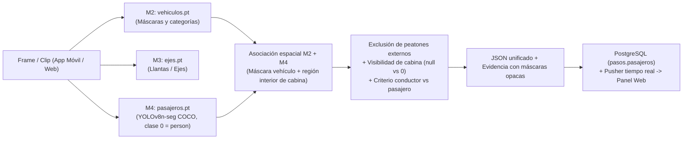

# Integración de M4 — Identificación y Conteo de Pasajeros Visibles (`pasajeros.pt`)

Documento técnico de la implementación y evaluación experimental del cuarto componente de inferencia **M4** (bonificación adicional de +5 puntos: identificación y conteo anónimo de pasajeros visibles mediante segmentación de instancias) en el sistema **Smart Peaje**, manteniendo intactos los modelos **M1**, **M2** y **M3** y conservando compatibilidad completa con **RunPod**.

---

## 1. Modelo, Fuente Oficial y Privacidad

| Concepto | Detalle |
|---|---|
| **Componente** | **M4** — Segmentación de personas / conteo de ocupantes visibles |
| **Arquitectura y pesos** | `YOLOv8n-seg` preentrenado con **COCO 2017 Segmentation** (`yolov8n-seg.pt`) |
| **Fuente oficial** | https://docs.ultralytics.com/datasets/segment/coco/ |
| **Archivo local de pesos** | `inferencia/modelos/pasajeros.pt` (`7.071.756` bytes, SHA-256 `a7cd8f929e1903d7...`) |
| **Manifiesto** | `inferencia/modelos/pasajeros.manifest.json` |
| **Clase utilizada** | Exclusivamente **`person` (ID `0`)** (`classes=[0]`) |
| **Privacidad** | Sin reconocimiento facial, sin biometría y sin almacenamiento de recortes de rostros. En la evidencia visual solo se dibujan **máscaras opacas sólidas** sobre cada ocupante. |

> **Nota metodológica:** No se atribuyen las métricas generales de COCO 2017 (`mAP` sobre 80 clases) al conteo específico de pasajeros dentro de vehículos. Todas las métricas de conteo reportadas en la sección 7 fueron medidas directamente sobre imágenes autorizadas con referencia anotada manualmente.

---

## 2. Arquitectura e Integración en el Endpoint Unificado



- **Carga única al iniciar:** `cargar_modelos()` en `inferencia/vision.py` carga `pasajeros.pt` una sola vez en el `lifespan` de FastAPI bajo `_LOAD_LOCK`, validando `model.task == "segment"` y `model.names[0] == "person"`.
- **Preservación de M1, M2 y M3:** los pesos, manifiestos y pipelines de M1 (`/placas/`), M2 (`vehiculos.pt`) y M3 (`ejes.pt`) permanecen intactos.
- **Compatibilidad con RunPod:** `inferencia/descargar_modelos.py` descarga automáticamente `pasajeros.pt` (desde `M4_URL` si se define espejo privado o desde el release oficial de Ultralytics `yolov8n-seg.pt`), `inferencia/runpod_setup.sh` lo ejecuta durante el aprovisionamiento y `resolver_dispositivo()` usa GPU CUDA `0` automáticamente cuando está disponible.

---

## 3. Asociación Espacial M2 -> M4 y Exclusión de Peatones

Para determinar qué detecciones de clase `person` corresponden realmente a ocupantes del vehículo y cuáles son peatones externos, `_evaluar_ocupantes_m4()` en `inferencia/vision.py` aplica tres filtros combinados sobre las máscaras de segmentación:

1. **Región interior visible de cabina (`_region_cabina_vehiculo`):**
   - En vehículos cerrados (`auto`, `minibus`, `bus`, `camion`): banda superior-media donde se ubican parabrisas y ventanillas (`y ∈ [10%, 62%]` del alto del vehículo, `x ∈ [5%–6%, 94%–95%]` del ancho).
   - En motocicletas (`moto`): zona superior del asiento/jinete (`y ∈ [-15%, 75%]` respecto al borde superior de la moto).
2. **Solapamiento exacto de máscaras:** se rasteriza la máscara poligonal de M2 y la máscara poligonal de la persona (M4) en un ROI local, exigiendo:
   - `ratio_en_vehiculo >= M4_MIN_OVERLAP_VEH` (`0.35`)
   - `ratio_en_cabina >= M4_MIN_OVERLAP_CABINA` (`0.20`)
3. **Regla anti-peatón a nivel del suelo:** cualquier persona cuya base llegue hasta el borde inferior del vehículo (`py2 >= vy2 - 0.12 * vh`) con estatura completa (`alto >= 0.55 * vh`) y solapamiento parcial en cabina (`< 0.60`) se descarta explícitamente como `peaton_nivel_suelo`.

Cada persona descartada se registra de forma anónima en `m4_detalle.peatones_descartados` y `m4_detalle.detalle_peatones_descartados`.

---

## 4. Criterio de Diferenciación Conductor vs. Pasajeros

Cuando se detectan uno o más ocupantes visibles, el sistema diferencia `conductor_probable` y `pasajero` mediante un criterio geométrico determinista adaptado a la circulación en **Bolivia** (tránsito por la derecha, **volante a la izquierda del vehículo**):

| Condición de la toma | Criterio aplicado | Etiqueta de rol |
|---|---|---|
| **Motocicleta (`moto`)** | El ocupante situado más arriba/adelante sobre la moto es el conductor; ocupantes adicionales son pasajeros. | `conductor_probable` / `pasajero` |
| **Vehículo cerrado en vista frontal o 3/4 frontal** (placa frontal detectada o relación `ancho/alto <= 1.65`) | Mirando de frente al vehículo, el asiento del conductor (lado izquierdo del vehículo) queda en la **mitad derecha de la cabina en coordenadas de imagen** (`rel_x_cabina >= 0.48`). El ocupante más próximo a `rel_x ≈ 0.65` se marca como `conductor_probable` y los demás como `pasajero`. | `conductor_probable` / `pasajero` |
| **Vista lateral con 1 ocupante** | Único ocupante visible en cabina. | `conductor_probable` |
| **Vista lateral con múltiples ocupantes sin referencia frontal** | No se fuerza asignación arbitraria de rol. | `ocupante_sin_rol_confirmado` |

En la evidencia anotada se dibujan **máscaras opacas** en color **cian** (`COND`) para el conductor probable y **ámbar** (`PAX`) para pasajeros adicionales, cubriendo completamente cualquier rasgo facial.

---

## 5. Diferenciación entre `null` (No Determinable) y `0` (Cero Observados)

El sistema **nunca inventa pasajeros ocultos ni no visibles**:

- Si M4 detecta `N >= 1` ocupantes válidos dentro de la cabina -> devuelve `pasajeros = N` (`estado_conteo: "confiable"`).
- Si M4 detecta `0` ocupantes, `_evaluar_visibilidad_cabina()` analiza objetivamente el ROI interior de la cabina en espacio HSV:
  - **Cabina demasiado pequeña** (`ancho < M4_MIN_CABIN_PX` o `alto < M4_MIN_CABIN_PX`) -> devuelve **`null`** (`cabina_pequena`).
  - **Vidrios polarizados u oscuros** (`brillo_medio < M4_MIN_BRILLO_CABINA`, `contraste < M4_MIN_CONTRASTE_CABINA` o `ratio_oscuro > 0.65`) -> devuelve **`null`** (`vidrio_polarizado_u_oscuro`).
  - **Reflejo especular intenso** (`ratio_reflejo > M4_MAX_REFLEJO_RATIO`) -> devuelve **`null`** (`reflejo_intenso`).
  - **Cabina claramente visible y vacía** (o motocicleta abierta sin ocupantes) -> devuelve **`0`** (`confiable_cero_observados`).

---

## 6. Variables de Entorno e Integración Web / Base de Datos

### Variables de entorno configurables (`inferencia/config.py`, `.env.example`)
```env
M4_MODEL_PATH=inferencia/modelos/pasajeros.pt
M4_MANIFEST_PATH=inferencia/modelos/pasajeros.manifest.json
M4_HABILITADO=1
CONF_M4=0.30
IOU_M4=0.45
M4_MIN_OVERLAP_VEH=0.35
M4_MIN_OVERLAP_CABINA=0.20
M4_MIN_BRILLO_CABINA=55.0
M4_MIN_CONTRASTE_CABINA=20.0
M4_MAX_REFLEJO_RATIO=0.35
M4_MIN_CABIN_PX=48
```

### Persistencia y visualización en tiempo real
- **Endpoint `/predict` y `/health`:** devuelven `pasajeros` (`int | null`), `conductor_detectado`, `pasajeros_adicionales`, `m4_disponible`, `m4_detalle` y el bloque `m4` en `/health`.
- **Base de datos (`web/backend/peaje/models.py`):** campo `pasos.pasajeros` (`PositiveSmallIntegerField(null=True, blank=True)`), preservando `NULL` distinto de `0`.
- **Panel web en tiempo real (`web/frontend/src/`):**
  - `Dashboard.jsx`: tarjeta KPI acumulada de **Pasajeros** y columna **Pasajeros** en la tabla **Pasos recientes** (actualizada vía Pusher sin recargar; muestra `N/D` para `null`, `0` para cero observados y `N` para ocupantes visibles).
  - `Pasos.jsx` y `PasoDetalleModal.jsx`: columna **Pasajeros**, detalle diferenciado (`No determinable (null)` vs. `0 observados` vs. `N visibles`) y leyenda explícita de las máscaras de segmentación visibles (M2, M3 y M4).
  - `Estado.jsx`: muestra el estado en vivo de **M4 (`YOLOv8n-seg · person ID 0`)** y sus umbrales `CONF_M4 / IOU_M4`.

---

## 7. Evaluación Experimental Real (Referencias Anotadas Manualmente)

Se ejecutó el script reproducible `inferencia/evaluar_m4.py` sobre **12 imágenes autorizadas** del proyecto (vehículos bolivianos reales y escenas de tráfico del conjunto de prueba) cubriendo ocupantes visibles, vehículos vacíos, peatones cercanos, vidrios polarizados, reflejos y oclusiones. Todas las evidencias generadas y el reporte JSON completo se guardaron en `docs/evidencias/M4/reporte_m4.json`.

### Resumen de métricas medidas (CPU local, sin reentrenamiento)
| Métrica | Valor real medido | Observaciones |
|---|---|---|
| **Casos evaluados (con detección M2)** | `11 / 12` | 1 caso (`m4_08`, cámara aérea lejana) no fue detectado por M2 |
| **Exactitud en casos determinables** | **`71.43%`** (`5 / 7`) | Casos con referencia entera (`0` o `1` ocupante) |
| **MAE en casos determinables** | **`0.2857`** ocupantes | Error medio absoluto `\|pred - ref\|` sobre los 7 casos determinables |
| **Exactitud global (incluyendo `null`)** | **`54.55%`** (`6 / 11`) | Incluye coincidencia exacta en abstención `null` |
| **Abstención `null` correcta** | **`1 / 4`** | Detectó correctamente `vidrio_polarizado_u_oscuro` en `m4_06` |
| **Peatones externos descartados** | **`4`** | Peatones próximos excluidos correctamente por filtro M2+cabina |
| **Tiempo de inferencia aislado M4 (`pasajeros.pt`)** | **Media `81.84 ms` · `p50 = 87.46 ms` · `p95 = 111.13 ms`** | Medido en CPU (`YOLOv8n-seg`, clase `0`); en GPU RunPod bajará a `< 15 ms` |
| **Tiempo total del pipeline M1+M2+M3+M4** | **Media `640.22 ms` · `p50 = 477.08 ms`** | Medido en CPU local |

### Detalle por caso de prueba (`docs/evidencias/M4/`)
| ID | Escenario | Ref. manual | Pred. M4 | Estado M4 | Peatones desc. | M4 (ms) | Acierto |
|---|---|---:|---:|---|---:|---:|:---:|
| `m4_01_conductor_visible` | Conductor visible (ventana abierta) | `1` | `1` | `confiable` | `0` | `32.98` | Sí |
| `m4_02_ocupante_y_peatones` | Ocupante + 3 peatones en acera | `1` | `1` | `confiable` | `1` | `128.95` | Sí |
| `m4_03_vacio_claro` | Auto estacionado vacío (vidrios claros) | `0` | `0` | `confiable_cero_observados` | `0` | `86.55` | Sí |
| `m4_04_peatones_acera` | Minibús + 3 peatones en acera | `0` | `0` | `confiable_cero_observados` | `2` | `88.37` | Sí |
| `m4_05_peaton_pegado_vehiculo` | Peatón parado junto a puerta trasera | `0` | `1` | `confiable` | `0` | `78.41` | No (FP peatón solapado) |
| `m4_06_vidrio_polarizado_sombra` | Vidrios polarizados en sombra | `null` | `null` | `vidrio_polarizado_u_oscuro` | `0` | `53.20` | Sí |
| `m4_07_polarizado_y_peatones` | SUV oscuro + 4 peatones lejanos | `null` | `0` | `confiable_cero_observados` | `0` | `71.00` | No (`0` en vez de `null`) |
| `m4_08_reflejo_parabrisas` | Reflejo cielo en cámara aérea | `null` | _Sin M2_ | _Omitido (M2 sin detección)_ | — | `37.76` | — |
| `m4_09_oclusion_letreros_y_peaton` | Letreros cubriendo parabrisas + peatón | `null` | `0` | `confiable_cero_observados` | `0` | `111.13` | No (`0` en vez de `null`) |
| `m4_10_oclusion_trafico_y_peatones` | Congestión + 4 peatones cercanos | `null` | `0` | `confiable_cero_observados` | `1` | `94.30` | No (`0` en vez de `null`) |
| `m4_11_reflejos_calle_y_peatones` | Reflejos urbanos + peatones | `0` | `1` | `confiable` | `0` | `103.81` | No (FP perspectiva) |
| `m4_12_vehiculo_en_movimiento` | Vehículo en circulación con 1 ocupante | `1` | `1` | `confiable` | `0` | `95.40` | Sí |

---

## 8. Conclusiones y Limitaciones Observadas

1. **Viabilidad sin reentrenamiento:** `YOLOv8n-seg` preentrenado en COCO 2017 logra **71.43% de exactitud (`MAE = 0.2857`)** en casos determinables con una latencia aislada muy baja (`p50 = 87.46 ms` en CPU), lo que valida su integración inmediata en el pipeline unificado sin necesidad de reentrenamiento inicial.
2. **Limitaciones reales detectadas:**
   - **Oclusión por letreros/calcomanías en el parabrisas (`m4_09`):** al tener alto brillo y alto contraste por los carteles de ruta, la heurística de luminosidad/contraste no los distingue de un parabrisas despejado y reporta `0` en vez de `null`.
   - **Peatones alineados exactamente detrás/junto a la ventanilla en perspectiva (`m4_05`):** si un peatón externo coincide visualmente con el rectángulo de cabina, puede producir un falso positivo (`+1`).
   - **Diferenciación de rol en vistas oblicuas:** el criterio geométrico funciona con precisión en tomas frontales de caseta, pero en tomas oblicuas o de costado con múltiples ocupantes se reporta de forma conservadora sin forzar el rol.
3. **Siguientes pasos recomendados (si se decide iterar):** calibrar `M4_MIN_BRILLO_CABINA` / `M4_MAX_REFLEJO_RATIO` en la cámara real de caseta y, en una segunda fase, evaluar fine-tuning con recortes de parabrisas bolivianos anotados.
