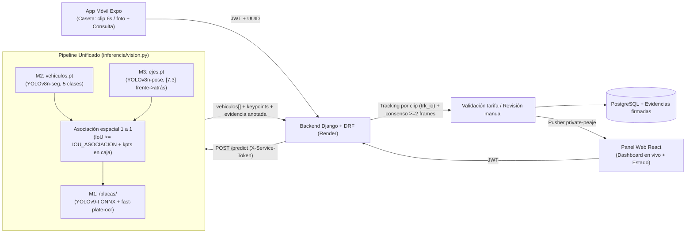

# Integración Completa de Modelos de IA (M1 + M2 + M3) — Smart Peaje

Documento técnico de la integración unificada de **M1** (localización de placas + OCR), **M2** (`vehiculos.pt`, YOLOv8n-seg) y **M3** (`ejes.pt`, YOLOv8n-pose `kpt_shape: [7, 3]`) en la arquitectura de producción del sistema de control de peaje.

---

## 1. Arquitectura final



### Decisiones clave de diseño
- **Carga única al iniciar (`lifespan`):** M1, M2, M3 y el modelo de pasajeros se cargan una sola vez bajo `_LOAD_LOCK`, validando `task` (`segment` / `pose`), `kpt_shape == [7, 3]` y coherencia de clases con `vehiculos.manifest.json` y `ejes.manifest.json`.
- **Asociación 1 a 1 M2 ↔ M3:** M3 corre una sola vez sobre la escena completa y se empareja de forma **uno a uno** con las detecciones de M2 mediante `IoU >= IOU_ASOCIACION` (`0.50`) y consistencia geométrica (`>=50%` de los keypoints visibles dentro de la caja M2). Ningún conjunto de ejes puede asignarse a dos vehículos distintos. Si existe un único vehículo sin emparejamiento global, se ejecuta un respaldo controlado sobre su recorte (`asociacion_metodo: "recorte_respaldo"`).
- **Distinción explícita de estado de ejes:** cada vehículo reporta `ejes_observados`, `ejes_estimados`, `keypoints_ejes` (coordenadas y confianza individual por `eje_1..eje_7`), `ejes_estado` (`confirmado`, `pendiente_confirmacion`, `incierto`, `sin_asociacion_m3`) y `limite_esquema_7_alcanzado`.
- **Política conservadora ante incertidumbre (sin cobros erróneos):**
  - Nunca se inventan coordenadas ni se completan ejes ocultos.
  - Los conteos de **4 ejes** y **7 ejes** (donde M3 reportó mayor dificultad y donde 7 representa el tope del esquema `[7, 3]`, no garantía de `<= 7` ejes reales), así como detecciones con keypoints en zona de confianza intermedia (`0.30..0.50`) o inconsistencias categoría/ejes, se marcan como `pendiente_confirmacion` y el backend registra el paso en estado **`revision`** (`monto = Bs 0.00`) generando una **Alerta** sin descontar saldo.
  - Los vehículos parcialmente visibles (`< 2` ejes observados) o con confianza M2 en zona baja (`0.50..0.60`) devuelven **HTTP 422** solicitando nueva captura sin generar cobro.
- **Seguimiento persistente y deduplicación en video:** en clips de 5–10 s, el backend asigna `track_id` (`trk_1`, `trk_2`, ...) entre frames por placa e IoU de caja, consolida por consenso (`>= 2` frames coincidentes) y garantiza idempotencia estricta por `captura_id` UUID en PostgreSQL.

---

## 2. Archivos modificados

| Archivo | Descripción |
|---|---|
| `inferencia/config.py` | Variables de entorno calibrables: `CONF_M2=0.50`, `IOU_M2=0.45`, `CONF_M2_COBRO=0.60`, `CONF_M3=0.25`, `CONF_KEYPOINT=0.50`, `IOU_ASOCIACION=0.50`, `INFERENCE_DEVICE=auto`, rutas a pesos y manifiestos. |
| `inferencia/vision.py` | Validación de `ejes.pt` (`task == "pose"`, `kpt_shape == [7, 3]`) y `ejes.manifest.json`, asociación espacial 1 a 1 M2↔M3, preservación de keypoints individuales, distinción `confirmado`/`pendiente_confirmacion`/`incierto`, visualización de máscaras M2 + keypoints numerados `e1..e7` conectados frente->atrás, y tolerancia a ausencia parcial de M1 conservando M2+M3. |
| `inferencia/.env.example` y `.env.example` | Plantillas actualizadas con todos los umbrales de M2 y M3. |
| `web/backend/peaje/services.py` | Envía a `estado="revision"` (`monto=0.00` + `Alerta`) cualquier paso con `ejes_estado == "pendiente_confirmacion"`, `requiere_revision_ejes` o `limite_esquema_7_alcanzado`. |
| `web/backend/peaje/views.py` | Seguimiento persistente `_asignar_track_id` en clips multi-frame y bloqueo HTTP 422 para baja confianza o ejes inciertos. |
| `web/backend/peaje/tests.py` | Prueba unitaria de revisión sin cobro en 7 ejes (`9077LAB`, `estado="revision"`, saldo intacto y alerta creada). |
| `web/frontend/src/pages/Estado.jsx` | Muestra los parámetros y estado en vivo de M2 y M3 (`CONF_M3 / CONF_KPT / IoU`, `kpt_shape [7, 3]`). |

---

## 3. Configuración inicial (sujeta a calibración en caseta real)

```env
INFERENCE_MODE=real
INFERENCE_DEVICE=auto
M2_MODEL_PATH=inferencia/modelos/vehiculos.pt
M2_MANIFEST_PATH=inferencia/modelos/vehiculos.manifest.json
M3_MODEL_PATH=inferencia/modelos/ejes.pt
M3_MANIFEST_PATH=inferencia/modelos/ejes.manifest.json
MAX_EJES=7

CONF_M2=0.50
IOU_M2=0.45
CONF_M2_COBRO=0.60
CONF_M3=0.25
CONF_KEYPOINT=0.50
IOU_ASOCIACION=0.50
PLACA_CONF=0.25
```

---

## 4. Endpoints y ejemplos reales de respuesta JSON

- **`GET /health`** (público): confirma `m1_detector: true`, `m1_ocr: true`, `m2_segmentacion: true`, `m3_keypoints: true`, manifiestos de M2/M3, `kpt_shape: [7, 3]`, umbrales activos y estado GPU.
- **`POST /predict`** (`X-Service-Token`, multipart `file` + `modo=caseta|consulta`): endpoint único para inferencia real.

### Ejemplo real de `POST /predict` (`modo=caseta`, camión de 6/7 ejes en `test`)
```json
{
  "placa": null,
  "placa_cruda": null,
  "confianza": null,
  "categoria": "camion",
  "clase_id": 2,
  "confianza_categoria": 0.71,
  "confianza_incierta": false,
  "ejes": 7,
  "ejes_observados": 7,
  "ejes_estimados": 7,
  "ejes_visibles": 7,
  "ejes_estado": "pendiente_confirmacion",
  "requiere_revision_ejes": true,
  "motivos_revision_ejes": ["limite_esquema_7_ejes_puede_superar_7"],
  "limite_esquema_7_alcanzado": true,
  "m3_disponible": true,
  "total_vehiculos": 1,
  "total_detecciones_m3_escena": 1,
  "asociaciones_m2_m3": 1,
  "vehiculos": [
    {
      "id_deteccion": "veh_1",
      "categoria": "camion",
      "confianza_categoria": 0.71,
      "bbox": [18, 86, 1762, 540],
      "zona_asociacion": {
        "iou_m2_m3": 0.89,
        "asociacion_metodo": "escena_iou_1a1"
      },
      "ejes_observados": 7,
      "ejes_estimados": 7,
      "ejes_estado": "pendiente_confirmacion",
      "keypoints_ejes": [
        {"nombre": "eje_1", "indice": 1, "x": 1750.2, "y": 518.0, "conf": 0.91, "visible": true},
        {"nombre": "eje_2", "indice": 2, "x": 1442.5, "y": 489.1, "conf": 0.94, "visible": true}
      ]
    }
  ],
  "modo_ejecucion": "real",
  "demo": false,
  "latencia_ms": 260
}
```

---

## 5. Resultados reales de las pruebas

Evidencias visuales con máscaras M2 + keypoints M3 numerados (`e1..e7`) y reporte completo guardados en `docs/evidencias/M3/validacion_integracion/` (`reporte_integracion_completa.json`).

### A. Conteo de ejes y asociación M2↔M3 sobre el conjunto `test` de `m3_adaptado_v2` (imágenes independientes)
| Ejes reales | Evaluadas | Detectadas M2 | Asociadas 1 a 1 M2↔M3 | Conteo exacto | Exactitud asociados | MAE |
|---:|---:|---:|---:|---:|---:|---:|
| **2** | 8 | 2 | 2 | 2 | **100.0 %** | `0.000` |
| **3** | 8 | 1 | 1 | 1 | **100.0 %** | `0.000` |
| **4** | 4 | 3 | 3 | 1 | **33.3 %** | `0.667` |
| **5** | 8 | 5 | 5 | 4 | **80.0 %** | `0.200` |
| **6** | 8 | 4 | 4 | 3 | **75.0 %** | `0.250` |
| **7** | 4 | 4 | 4 | 2 | **50.0 %** | `0.500` |
| **Total** | **40** | **19** | **19 (100 %)** | **13** | **68.42 %** | **`0.3158`** |

### B. Otras pruebas verificadas en modo `real`
- **Las 5 categorías de M2:** validadas en [INTEGRACION_M2.md](INTEGRACION_M2.md) (`auto`, `bus`, `camion`, `minibus`, `moto`).
- **Oclusión parcial (mitad de camión de 5 ejes):** observó 3 ejes visibles sin inventar los 2 ocultos y activó `ejes_estado: "pendiente_confirmacion"` (`keypoints_confianza_intermedia: 1`).
- **Video MP4 de 6.0 s (5 frames muestreados de un camión de 5 ejes):** 5/5 frames procesados con IoU M2↔M3 entre `0.47` y `0.85`; 3/5 frames confirmaron exactamente `5 ejes` (`confirmado`), imponiéndose por consenso frente a los 2 frames de borde (`4` y `3`, marcados `pendiente_confirmacion`).
- **M1 en imagen completa (`640×360`):** detectó y leyó `9000LAB` con confianza **`0.9775`**.
- **Imagen sin vehículos:** HTTP `422` (`No se detectó ningún vehículo; capture otra toma`).
- **Latencia real en CPU local (M1+M2+M3):** `min = 165 ms`, **`p50 = 260 ms`**, `promedio = 425.2 ms`, `p95 = 756.4 ms`.
- **Suite del sistema:** Backend Django `manage.py test peaje -v 2` (**4/4 OK**), Frontend `npm run build` (**OK**), Móvil `npx tsc --noEmit` (**OK**).

---

## 6. Limitaciones observadas y tareas pendientes

1. **Clasificación M2 en perfil lateral estricto a contraluz:** en 3 de 17 camiones laterales de `usp_truck_v2` (carretera brasileña, fuera del dominio boliviano de M2), M2 clasificó furgones/plataformas como `bus`. En caseta real (vista oblicua 3/4 con cabina y placa visibles) esta confusión disminuye y además queda protegida por la verificación contra el vehículo registrado en BD (`estado="revision"` si difiere).
2. **Dificultad conocida de M3 en 4 y 7 ejes:** confirmada en las pruebas (`33.3 %` y `50.0 %`). Mitigada enviando automáticamente 4 y 7 ejes a `estado="revision"` sin cobro definitivo hasta confirmación del operador.
3. **Límite superior de 7 posiciones:** `kpt_shape: [7, 3]` no garantiza que un vehículo no tenga `8` o `9` ejes reales; todo conteo de 7 marca `limite_esquema_7_alcanzado: true` y requiere revisión.
4. **Tareas pendientes para despliegue definitivo:**
   - Subir `vehiculos.pt`, `vehiculos.manifest.json`, `ejes.pt` y `ejes.manifest.json` al Pod GPU de **RunPod** (o Colab) y verificar `GET /health` con `gpu: true`.
   - Calibrar `CONF_M2`, `CONF_M3`, `CONF_KEYPOINT` e `IOU_ASOCIACION` sobre clips reales de 5–10 s grabados desde la app móvil en la caseta y completar la tabla final en `docs/metricas.md` y `docs/pruebas.md`.
