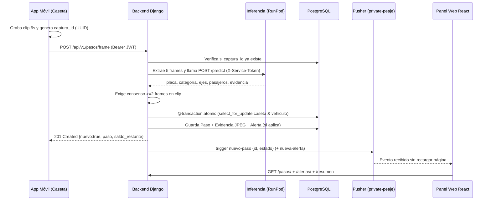

# Arquitectura Técnica — Smart Peaje

## 1. Componentes y responsabilidades

| Componente | Directorio | Despliegue | Responsabilidad principal |
|---|---|---|---|
| **M1 OCR existente** | `/placas/` | Incluido en Inferencia | Detector YOLOv9-t ONNX + `fast-plate-ocr` (sin modificar) |
| **Servicio Inferencia** | `/inferencia/` | RunPod GPU Pod (puerto 8000) | API FastAPI (`/health`, `/predict`) que unifica M1, M2, M3 y pasajeros |
| **Backend Web** | `/web/backend/` | Render Web Service + PostgreSQL | API REST (`/api/v1/`), JWT, Google Auth, lógica de peaje, Pusher y Agente |
| **Frontend Web** | `/web/frontend/` | Render Static Site | Panel en tiempo real, CRUDs admin, historial, chat del agente y estado |
| **App Móvil** | `/movil/` | Expo EAS Build (APK Android) | Login Google nativo, Modo Caseta (clip 5-10 s / foto) y Modo Consulta |
| **Entrenamiento** | `/entrenamiento/` | Google Colab GPU | Notebooks para entrenar M2 (`vehiculos.pt`) y M3 (`ejes.pt`) |

## 2. Flujo Modo Caseta (tiempo real e idempotencia)

## 3. Seguridad y privacidad

- **Autenticación exclusiva con Google OAuth 2.0:** el backend verifica el `id_token` con `google-auth` contra `GOOGLE_CLIENT_IDS` y valida la lista blanca en `peaje.Usuario` (`is_active=True`).
- **Imágenes de evidencia privadas:** se almacenan en PostgreSQL (`peaje.Evidencia`, evitando el disco efímero de Render) y se exponen únicamente mediante URLs firmadas con `TimestampSigner` (`max_age=900` segundos).
- **Privacidad de pasajeros:** las detecciones de personas dentro del vehículo se cubren con máscara sólida opaca en la imagen de evidencia; nunca se realiza reconocimiento facial ni se guardan recortes de rostros.
- **Aislamiento de inferencia:** `INFERENCE_URL` e `INFERENCE_TOKEN` viven en variables de entorno para poder alternar entre RunPod, Colab o pruebas locales sin tocar código.
